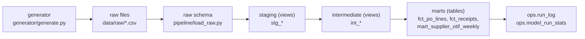

# Northfield Market Supplier OTIF Scorecard

**Jacob Jensrud**

## The problem

Northfield Market's procurement team reviews supplier performance every Monday.
Today that review relies on buyer anecdotes and a manually updated spreadsheet.
This data product publishes a weekly on-time-in-full (OTIF) scorecard for every supplier delivering to our two distribution centers.
Data refreshes daily by 6:00 a.m. Central, and a week's score stays provisional until seven days after it closes.

**Decision it supports:** which suppliers vendor managers escalate, charge back under the vendor compliance agreement, or renegotiate.

## Video walkthrough

[Watch the walkthrough on Google Drive](https://drive.google.com/file/d/1RvFGMDm5acA61sFsok5ec05XaQ-GP4Bp/view?usp=sharing)

## What it produces

Three published tables in the DuckDB schema `main_marts` (full column list: [docs/data_dictionary.md](docs/data_dictionary.md)):

| Table | One line |
|---|---|
| `fct_po_lines` | One row per PO line with eligibility, on-time, in-full, OTIF, missed, over-shipment, and provisional flags. |
| `fct_receipts` | One row per dock receipt, including unscoreable ones flagged with `receipt_issue`; incremental. |
| `mart_supplier_otif_weekly` | The scorecard: one row per supplier per ISO week with OTIF %, on-time %, in-full %, and case fill rate. |

Sample: the five lowest OTIF suppliers in week 2026-W41 (final), from the default run (`run_date` 2026-10-25):

| supplier_id | supplier_name | week | eligible_lines | otif_pct | on_time_pct | in_full_pct | case_fill_rate_pct | is_provisional |
|---|---|---|---|---|---|---|---|---|
| SUP017 | Prairie Harvest Foods | 2026-W41 | 6 | 33.33 | 50.00 | 33.33 | 96.47 | false |
| SUP025 | Cannon Valley Distributing | 2026-W41 | 38 | 50.00 | 71.05 | 50.00 | 84.41 | false |
| SUP044 | Iron Range Foods | 2026-W41 | 23 | 52.17 | 69.57 | 52.17 | 93.72 | false |
| SUP023 | Golden Valley Brands | 2026-W41 | 9 | 55.56 | 77.78 | 55.56 | 81.82 | false |
| SUP034 | Heartland Supply Co. | 2026-W41 | 18 | 55.56 | 72.22 | 55.56 | 83.61 | false |

All data is synthetic (see [ADR 0002](docs/adr/0002-data-source.md)).

## Prerequisites

- **Python 3.11 or newer** (developed and tested on 3.14.7).
- **Git.**
- **make.** macOS and Linux include it.
  - **Windows:** install it with `winget install ezwinports.make`, then run every command below from **Git Bash**. The Makefile uses POSIX shell syntax.

## Quickstart

```sh
git clone https://github.com/jensrudj-debug/Northfield-Market-Supplier-Scorecard.git
cd Northfield-Market-Supplier-Scorecard
python -m venv .venv
source .venv/Scripts/activate        # Windows (Git Bash)
# source .venv/bin/activate          # macOS / Linux
pip install -r requirements.txt
cp .env.example .env                 # optional: the Makefile loads .env; defaults work without it
make run
```

`make setup` does the venv, install (including test tools), and `dbt deps` steps in one command.

`make run` generates the data, loads it, installs dbt packages, checks source freshness, runs `dbt build --full-refresh`, and records run stats.
It ends with a summary like this. Timings vary by machine; this one is from a clean clone state (run `e337b87748ec`):

```text
Run e337b87748ec  mode=full  run_date=2026-10-25  logs=.../logs/e337b87748ec
step                   status     seconds  detail
---------------------- --------- --------  ------------------------------
generate               success       12.8
load_raw               success       28.0
dbt_deps               success       16.8
dbt_source_freshness   success       29.6
dbt_build              success       26.5
record_model_stats     success        1.1

dbt nodes: model success=12, test pass=124, test warn=3, unit_test pass=11
```

The 3 warnings are expected. They flag the injected orphan receipts, missing timestamps, and zero-case receipts.

Other targets:

| Command | What it does |
|---|---|
| `make setup` | Creates `.venv`, installs `requirements-dev.txt`, and runs `dbt deps`. |
| `make test` | Runs the pytest suites, then `dbt test` against the built warehouse (run `make run` first). |
| `make build` | Runs `dbt build` (incremental) against the current warehouse. |
| `make daily RUN_DATE=2026-10-25` | Loads one receipt partition and runs an incremental build. Dates must move forward; use `make run RUN_DATE=...` to backfill. |
| `make docs` | Regenerates [docs/data_dictionary.md](docs/data_dictionary.md); fails if any published column lacks a description. |
| `make generate` / `make load` | Runs the generator or the raw loader on its own. |
| `make run-10x` | Full run at 10x PO volume into `warehouse/otif_10x.duckdb` (for [docs/cost_profile.md](docs/cost_profile.md)). |
| `make clean` | Deletes all generated data, warehouses, logs, and dbt artifacts; keeps `.venv`. |

## Run order



`pipeline/run_pipeline.py` runs these steps in order. It writes one `ops.run_log` row per step and one `ops.model_run_stats` row per dbt node.

## Definitions, tests, decisions, cost, limitations

### Metric definitions

OTIF is measured per PO line: on time is a first receipt from 1 day early to 0 days late, and in full is at least 98% of ordered cases received inside that window.
Lines are scored in the ISO week of the requested delivery date. Full definitions are in [docs/charter.md](docs/charter.md); thresholds are dbt vars in `otif_dbt/dbt_project.yml`.

### Testing approach

Run everything with `make test`.

- `dbt build` runs 127 data tests and 11 unit tests. The unit tests cover every charter boundary: on-time edges, exactly 98% in full, missed at +7 vs +8 days, provisional cut-off, and ISO week 53.
- Seven singular tests in `otif_dbt/tests/` state a business rule each, for example "every PO line is scored exactly once".
- Three tests are expected to warn, with documented counts: 174 orphan receipts, 87 missing timestamps, and 87 zero or negative quantities (see `otif_dbt/models/staging/_staging_models.yml`).
- Five pytest tests in `generator/tests` and `pipeline/tests` check generator determinism, injected data-quality counts, and loader idempotency.

### Architecture decisions

Full index: [docs/adr/README.md](docs/adr/README.md).

| ADR | Decision |
|---|---|
| [0001](docs/adr/0001-warehouse.md) | DuckDB single file for clone-and-run reproducibility. |
| [0002](docs/adr/0002-data-source.md) | Seeded synthetic data with counted, injected data-quality issues. |
| [0003](docs/adr/0003-measurement-grain.md) | PO-line OTIF primary; case fill rate secondary. |
| [0004](docs/adr/0004-on-time-window-and-attribution.md) | -1/+0 day window; ISO week of the requested date. |
| [0005](docs/adr/0005-in-full-rule.md) | 98% of cases inside the window; over 105% flagged. |
| [0006](docs/adr/0006-refresh-strategy.md) | `fct_receipts` incremental; line fact and mart rebuilt in full. |
| [0007](docs/adr/0007-late-arriving-data.md) | Restate with `is_provisional` for 7 days, computed from `run_date`. |
| [0008](docs/adr/0008-orphan-receipts.md) | Keep and flag orphan receipts; warn, do not fail. |
| [0009](docs/adr/0009-scorecard-grain.md) | Supplier x ISO week scorecard. |

### Cost summary

Measured on a 4-core laptop ([docs/cost_profile.md](docs/cost_profile.md)):
- A full run took 128.9 s, and a daily run averaged 100.5 s.
- At 10x volume, the full run took 134.4 s.
- Run time is dominated by fixed overhead, not data volume.
- On Snowflake Standard X-Small, the estimate is about $2.07 per month at 1x and $2.25 at 10x. Snowflake's 60-second billing minimum dominates the cost.

### Known limitations and assumptions

Top five; the full list is in [docs/limitations.md](docs/limitations.md).

1. **Synthetic data.** Supplier behavior is assumed, not observed.
2. **DC deliveries only.** Direct-store delivery vendors are not covered.
3. **Dates, not appointment times.** Six hours late on the right day counts as on time.
4. **No root-cause attribution.** Carrier delays and DC dock congestion count against the supplier.
5. **No scheduler, retries, or alerting.** A failed run needs a person to notice.

## Repository layout

```text
.
├── config/
│   ├── generator.yml           # generator settings: seed, volumes, rates, DQ injection
│   └── generator_10x.yml       # 10x PO volume for the cost profile
├── docs/
│   ├── charter.md              # problem, metric definitions, scope
│   ├── data_dictionary.md      # generated by make docs
│   ├── cost_profile.md         # measured run times and Snowflake estimate
│   ├── limitations.md
│   └── adr/                    # architecture decision records 0001-0009
├── generator/
│   ├── generate.py             # deterministic synthetic data generator
│   └── tests/
├── pipeline/
│   ├── load_raw.py             # idempotent CSV -> DuckDB raw loader
│   ├── run_pipeline.py         # full / daily orchestrator with ops logging
│   ├── build_data_dictionary.py
│   └── tests/
├── otif_dbt/                   # dbt project (staging, intermediate, marts, tests)
├── Makefile
├── requirements.txt            # runtime dependencies
├── requirements-dev.txt        # runtime + pytest
└── .env.example                # optional local settings, loaded by the Makefile
```

Generated and ignored by git: `data/`, `warehouse/`, `logs/`, `.venv/`, `.env`, `otif_dbt/target/`, `otif_dbt/dbt_packages/`.
